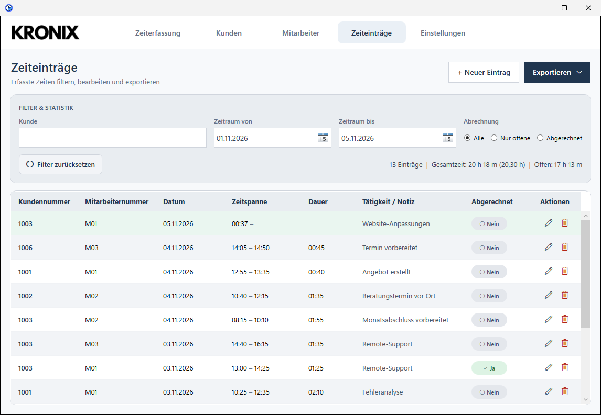
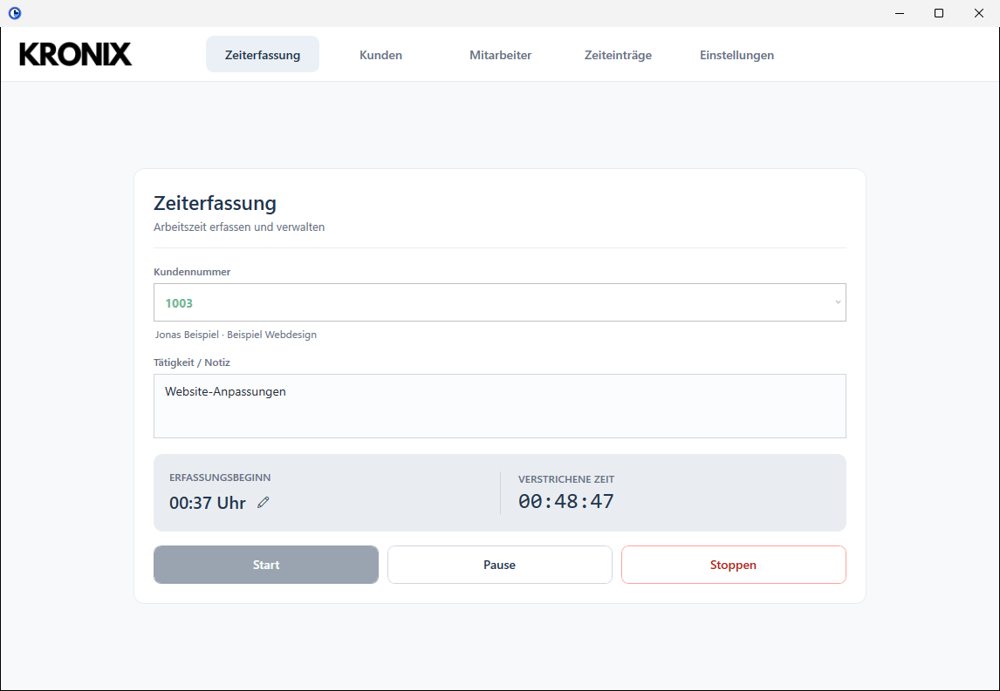
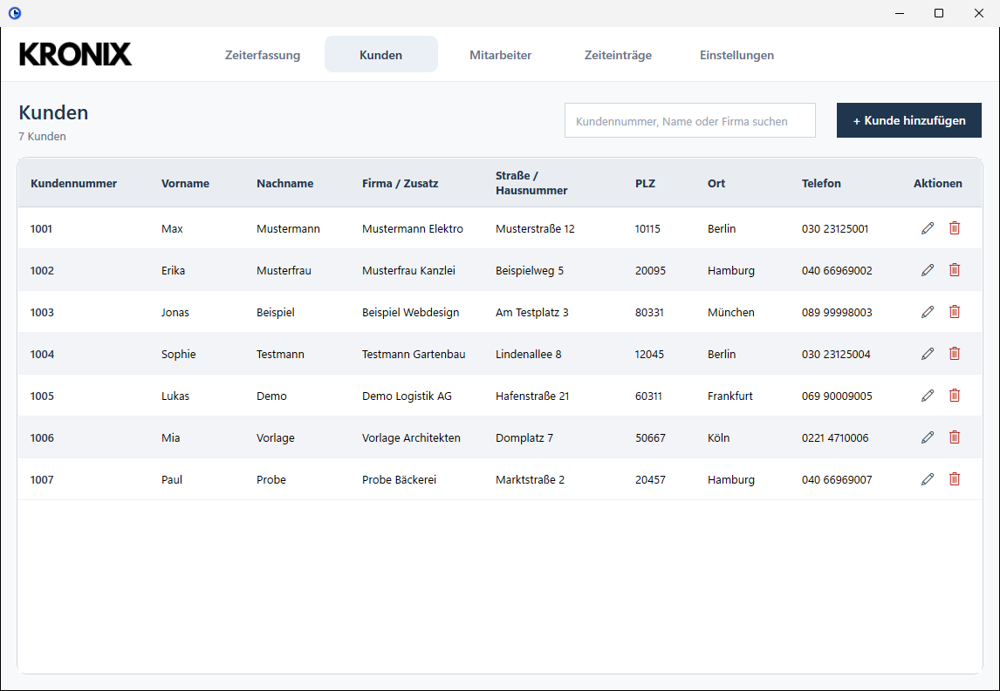

<div align="center">

<picture>
  <source media="(prefers-color-scheme: dark)" srcset="docs/logo-dark.png">
  <source media="(prefers-color-scheme: light)" srcset="docs/logo-light.png">
  
</picture>

[](https://github.com/roemertimon/Kronix/actions/workflows/build.yml)  

</div>

**Kronix** is a Windows desktop application for tracking work hours and managing customer records. It includes a customer directory, a timer, searchable time entries, billing status, and Excel and PDF exports.

> The application interface is currently in German.

## Features

- Track time for a customer, pause and resume the timer, and add notes to entries.
- Keep customer contact details in one searchable directory.
- Manage employees, choose the current employee, and attribute every time entry to one.
- Add or edit time entries manually, with separate date and time fields.
- Filter entries by customer, date, and billing status, then review duration totals.
- Update billing status for one entry or a group of selected entries.
- Export filtered entries to Excel or PDF, with optional customer separation and billing summaries.
- Back up the SQLite database to a ZIP archive and restore a backup to a new file.
- Review application events and errors in the built-in log viewer.
- Keep Kronix available from the Windows notification area.

## Screenshots

The interface is in German. All screenshots use fictitious demo data.

<p align="center">
  
</p>

<table>
  <tr>
    <td width="50%" align="center"><br>Time tracking</td>
    <td width="50%" align="center"><br>Customers</td>
  </tr>
</table>

## Getting started

### Requirements

- Windows
- [.NET 8 SDK](https://dotnet.microsoft.com/download/dotnet/8.0) with the Windows desktop targeting pack

### Build and run

Clone the repository, then run the application from its root directory:

```powershell
git clone https://github.com/roemertimon/Kronix.git
cd Kronix
dotnet run --project Kronix.csproj
```

To build without starting the application:

```powershell
dotnet build Kronix.sln
```

The .NET SDK restores the NuGet dependencies during the first build. Run the tests with `dotnet test Kronix.sln`. To just run Kronix, download `Kronix-win-x64.zip` from the [Releases](../../releases) page; it is self-contained and needs no .NET install. Every push is built and tested by GitHub Actions, which also publishes a self-contained Windows build as a workflow artifact.

## Using Kronix

### Time tracking

Choose a customer in the time-tracking view and start the timer. You can pause and resume the current entry, add a note, adjust its start time, and stop it when the work is complete. Kronix rounds tracked end times up to a five-minute increment.

Entries can also be added manually. The editor has separate date and time fields for the start and end, plus controls for rounding to five-minute increments.

New entries store UTC instants alongside local display times, so durations remain accurate across daylight-saving changes. Existing database entries keep their recorded wall-clock times because their original UTC offsets cannot be reconstructed. A manually entered time that is skipped or repeated during a clock change is rejected when it cannot be mapped to one instant.

When Kronix exits, it closes any running time entry. On the next start, it also checks for unfinished entries and closes them during database recovery.

### Customers

The customer list can be searched by customer number, name, company, address, or phone number. A customer cannot be deleted while time entries are still associated with that customer.

### Time entries

The time-entry view supports filtering by:

- One or more customer numbers (separated by commas)
- Start-date range
- Billed or unbilled status

The view displays the filtered entry count and duration totals. Billing status can be changed from an entry's row, or for all selected entries at once.

| Action | Keyboard shortcut |
| --- | --- |
| Edit the selected time entry | `E` (single selection) |
| Delete selected completed time entries | `Delete` |
| Edit the selected customer | `E` |
| Delete the selected customer | `Delete` |

Delete actions ask for confirmation. A customer with existing time entries cannot be deleted. Double-clicking a customer row also opens the customer editor.

### Exporting

Export the currently filtered time entries as an Excel workbook (`.xlsx`) or PDF. Export options include:

- Separating entries by customer (separate worksheets in Excel or pages in PDF)
- Including a billing summary
- Showing durations as decimal hours or `HH:mm`
- Marking successfully exported entries as billed (off by default)

## Data and backups

Kronix stores data in a local SQLite database. By default, the active database is:

```text
%LOCALAPPDATA%\Kronix\kundenDaten.sqlite
```

On first launch, Debug builds may copy an empty bundled `Resources\kundenDaten.sqlite` into that folder. Release builds and GitHub releases never include a database, hotkey, current employee, or any local file path; if no bundled database is found, Kronix creates a new empty one. Per-machine settings stay only on the PC:

```text
%LOCALAPPDATA%\Kronix\database-path.txt
%LOCALAPPDATA%\Kronix\current-employee.txt
%LOCALAPPDATA%\Kronix\hotkey.txt
%LOCALAPPDATA%\Kronix\workstation-id.txt
```

The database contains customer records and time entries, including notes and billing status. Use **Settings** to view the active path, select a database, create a new empty database, run an integrity/schema check, or create and restore ZIP backups. Restoring a backup creates a new database file; it does not overwrite the selected destination.

**Protect your data:** database files contain customer and time-tracking information. Keep backup archives secure and do not publish real customer data. The application log is stored separately and is designed not to include customer records or time-entry notes.

## Application logs

Logs are stored under:

```text
%LOCALAPPDATA%\Kronix\Logs\
```

The log records application events and errors. Kronix rotates the log when it reaches approximately 1 MB and keeps up to three previous log files. The log viewer and a shortcut to the log folder are available in Settings.

## Project structure

```text
Kronix/
├── Database/       SQLite access, schema management, backup and restore
├── docs/           README logo, social preview banner, and screenshots
├── Logging/        Application logging
├── Media/          Application media assets
├── Resources/      Icons, images, animation, and bundled sample database
├── Tests/          xUnit tests for the data layer
├── Windows/        WPF views, dialogs, and export implementations
├── App.xaml        WPF application entry point and shared resources
├── Kronix.csproj   Target framework and NuGet dependencies
└── Kronix.sln      Visual Studio/Rider solution
```

## Built with

- C# and WPF on .NET 8 for Windows
- [Microsoft.Data.Sqlite](https://www.nuget.org/packages/Microsoft.Data.Sqlite) for SQLite access
- [ClosedXML](https://www.nuget.org/packages/ClosedXML) for Excel export
- [PDFsharp-WPF](https://www.nuget.org/packages/PDFsharp-WPF) for PDF export
- [WpfAnimatedGif](https://www.nuget.org/packages/WpfAnimatedGif) for animated UI assets

PDFsharp 6.2.4 is MIT-licensed, which is compatible with Kronix's license.

## License

Kronix is source-available under the [PolyForm Noncommercial License 1.0.0](LICENSE) (SPDX: `PolyForm-Noncommercial-1.0.0`). You may use, study and modify it for personal, educational and other noncommercial purposes. **Commercial use requires my prior written approval** - contact me via [GitHub](https://github.com/roemertimon).

Third-party libraries retain their own licenses. The license does not grant rights to use Kronix branding or logos.
